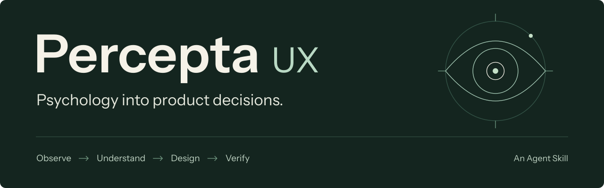

<h1 align="center">
  <picture>
    <source media="(max-width: 600px)" srcset="https://raw.githubusercontent.com/lrzdeveloper/percepta-ux/main/docs/assets/percepta-header-compact.svg">
    
  </picture>
</h1>

<p align="center">
  <a href="package.json"></a>
  <a href="package.json"></a>
  <a href="https://agentskills.io/specification"></a>
  <a href="LICENSE"></a>
</p>

<p align="center">
  <a href="https://www.npmjs.com/package/@lrzdeveloper/percepta-ux"></a>
  <a href="https://skills.sh/lrzdeveloper/percepta-ux/percepta-ux"></a>
</p>

<p align="center">
  <a href="https://www.npmjs.com/package/@lrzdeveloper/percepta-ux"></a>
  <a href="https://github.com/lrzdeveloper/percepta-ux/actions/workflows/validate.yml"></a>
  <a href="https://skills.sh/lrzdeveloper/percepta-ux"></a>
</p>

<p align="center">
  An Agent Skill for the decisions between research and implementation.<br>
  Understand the obstacle. Make the change. Check the outcome.
</p>

<p align="center">
  <a href="#quick-start">Quick start</a> &nbsp;·&nbsp;
  <a href="#commands">Commands</a> &nbsp;·&nbsp;
  <a href="#the-method">The method</a> &nbsp;·&nbsp;
  <a href="#knowledge-map">Knowledge map</a> &nbsp;·&nbsp;
  <a href="#validation">Validation</a>
</p>

---

## Quick start

**Install once. Use in your coding agents.**

Run Percepta's installer from npm:

```bash
npx @lrzdeveloper/percepta-ux
```

Or use the skills CLI:

```bash
npx skills add lrzdeveloper/percepta-ux --skill percepta-ux
```

To run directly from GitHub, use `npx git+https://github.com/lrzdeveloper/percepta-ux.git`.
For a global CLI, run `npm install -g @lrzdeveloper/percepta-ux`, then `percepta-ux`.

**Requires:** Node.js **22.20+**, npm/npx, and Git.
The npx wrapper supports macOS and Linux; use skills directly on other platforms.
In a terminal, skills offers agent, scope, and installation-method selection.
Inside an agent or without a terminal, its normal detection behavior applies.

<details>
<summary><strong>Choose agents, scope, and installation options</strong></summary>

Install globally for Claude Code and Codex:

```bash
npx @lrzdeveloper/percepta-ux install -g -a claude-code codex
```

Equivalent skills command:

```bash
npx skills add lrzdeveloper/percepta-ux --skill percepta-ux -g -a claude-code codex
```

Run from your project for a project-scoped install. Add `-g` for a global install,
`--copy` for independent copies instead of symlinks, or `-y` to skip confirmation.
Both routes install the same skill through the skills CLI's agent selection.

The wrapper has no npm dependencies of its own. It runs **skills@1.7.4** through
npx and selects the matching Percepta version tag. Installation records retain
that ref; rerun the desired release installer to change Percepta versions. Updates
to the skills CLI pin should be tested before changing it. No MCP setup is required.

</details>

<details>
<summary><strong>Inspect, update, or remove an installation</strong></summary>

```bash
# Discover without installing
npx @lrzdeveloper/percepta-ux install --list

# Preview the command without running it
npx @lrzdeveloper/percepta-ux install --dry-run

# Check local prerequisites
npx @lrzdeveloper/percepta-ux doctor

# Manage installed skills
npx @lrzdeveloper/percepta-ux list
npx @lrzdeveloper/percepta-ux update
npx @lrzdeveloper/percepta-ux uninstall
```

For global listing or removal, add `-g`; select agents as needed. You can also
use `npx skills list`, `npx skills update percepta-ux`, and
`npx skills remove percepta-ux` directly. Existing installations follow the
underlying skills CLI's update and removal behavior.

</details>

### Distribution

The public npm package is [`@lrzdeveloper/percepta-ux`](https://www.npmjs.com/package/@lrzdeveloper/percepta-ux);
the installed command is `percepta-ux`. The portable skill is available through
[skills.sh](https://skills.sh/lrzdeveloper/percepta-ux/percepta-ux) and the
[GitHub release](https://github.com/lrzdeveloper/percepta-ux/releases/tag/v0.2.0).
The npm installer selects the GitHub tag matching its package version. For a
reproducible install, use `npx @lrzdeveloper/percepta-ux@0.2.0`.

The skills.sh catalog tracks installations made through the skills CLI. The
wrapper opts out of that reporting; the direct skills command uses the CLI's
normal telemetry settings.

The wrapper uses **skills@1.7.4** and disables its telemetry and security-audit
requests for that invocation. With skills directly, use `DISABLE_TELEMETRY=1` for
the same telemetry setting. Installation preserves global authentication settings.

## Commands

Fifteen focused workflows, inside one skill. Use `/percepta-ux <command>` in Claude
Code or `$percepta-ux <command>` in Codex. These are skill modes, not fifteen
independently registered slash commands. With a plain-language task, the agent
can choose the relevant mode; the skill name alone shows its menu.

| Workflow | Result |
|:--|:--|
| `help` | Show the available workflows and suggest a relevant starting point. |
| `audit` | Diagnose and prioritize UX issues without changing the artifact. |
| `design` | Create a task-centered interface or implement the requested design. |
| `flow` | Design the states, decisions, recovery, and ending of a user journey. |
| `component` | Specify, select, build, or improve a component and its interaction states. |
| `polish` | Refine hierarchy and visual details within the existing product identity. |
| `clarify` | Make labels, messages, and recovery wording understandable and truthful. |
| `adapt` | Adapt a task to a different device, input, or platform while preserving capability. |
| `harden` | Improve content, failure, interruption, and recovery behavior within scope. |
| `motion` | Design useful, interruptible motion with accessible alternatives. |
| `research` | Choose a research method and produce a usable study plan. |
| `principles` | Turn team priorities into actionable, revisable design rules. |
| `ethics` | Review persuasion, defaults, user agency, and protective friction. |
| `verify` | Check the actual outcome and report remaining evidence gaps. |
| `references` | Select relevant design references or component resources for this task. |

```text
/percepta-ux audit the checkout flow; report findings without changing source
$percepta-ux component improve this save button within our existing Vue system
/percepta-ux motion specify pending, confirmed, rejected and reduced-motion states
```

The terminal can show the menu or build text to paste into your agent:

```bash
npx @lrzdeveloper/percepta-ux commands
npx @lrzdeveloper/percepta-ux prompt polish "Improve the dashboard while preserving our design system"
```

For a request that should carry its guidance with it, generate a complete prompt:

```bash
npx @lrzdeveloper/percepta-ux@0.2.0 prompt --with-context research "Plan a study for our help center; maximum 150 words"
```

This prints the actual skill entrypoint, selected workflow, and every guide linked
directly by that recipe, followed by a completion marker. Paste the result into
your agent. It supplies the context in full before the agent chooses tools;
ordinary automatic selection and `/percepta-ux research` remain available. A
prepared prompt is a context-loading route, not a guarantee about model decisions.

`commands` works offline once the package is available. `prompt` prints text;
it does not run an AI, edit a project, or install components. Read the
[workflow recipes](skills/percepta-ux/SKILL.md#choose-a-workflow) for scope and completion criteria.

<details>
<summary><strong>Visual craft and component references</strong></summary>

The original [visual craft](skills/percepta-ux/references/visual-craft.md),
[component](skills/percepta-ux/references/components.md), and
[motion](skills/percepta-ux/references/motion.md) guides connect execution to the UX core.
The [interaction patterns](skills/percepta-ux/references/interaction-patterns.md)
guide covers tactile feedback, changing labels, deliberate confirmation and undo,
file acquisition, and persistent outcomes. The
[selection guide](skills/percepta-ux/references/reference-selection.md) turns an
outside example into a fitting local solution. Existing primitives, the project's
framework, accessibility, truthful state, and visual commitments guide selection.
No third-party skill, paid source, MCP, or rendering tool is bundled or installed.

</details>

<details>
<summary><strong>Context, wording, and verification</strong></summary>

[Product context](skills/percepta-ux/references/product-context.md) resolves the
brief from existing evidence without requiring new context files.
[UX copy](skills/percepta-ux/references/ux-copy.md) supports truthful state,
clear actions, and usable recovery.
[Review loop](skills/percepta-ux/references/review-loop.md) connects the promised
change to checks on the actual result, with source-only fallbacks.

For a resolved opaque sRGB pair, run from the installed skill folder:

```bash
node scripts/contrast.mjs '#777777' '#FFFFFF'
```

For a capped response, the optional `scripts/word-count.mjs --max N` reads a draft
from stdin and returns its count and exact text. An over-limit draft exits 1 and
needs revision; the checked draft should be returned without later expansion.
The optional `scripts/load-context.mjs MODE [GUIDE ...]` reads only bundled recipes
and guides. It is a fallback for hosts without a dedicated file reader. It prints
complete files with end markers; filtered previews do not establish full loading.
Both helpers run locally with Node and use no network or project-file writes.

The contrast calculator reads only its arguments and returns an
unrounded ratio; it neither chooses the applicable criterion nor certifies the UI.
[Scope and standards](skills/percepta-ux/references/standards.md#optional-contrast-calculation).

</details>

## Built for the work

| | Use Percepta to… | Get a concrete result |
|:--:|:--|:--|
|  | **Review an interface** | Locate obstacles in navigation, forms, onboarding, controls, or an entire journey. |
|  | **Design and implement** | Translate a relevant psychological mechanism into a component, state, or workflow change. |
|  | **Plan the research** | Choose a method that answers the uncertainty, with tasks, participants, and observable outcomes. |
|  | **Align a team** | Turn a product priority into a useful design rule, with an application, exception, and review criterion. |

The core guidance works without an MCP server, a network connection, or Node. The optional contrast helper runs locally with Node
and calculates only an opaque sRGB color pair; it does not inspect a page. Tools help inspect a real product; missing tools
become explicit evidence limits. Current standards may need official-source
verification. The skill supports UX decisions rather than prescribing a visual
style or providing complete accessibility certification.

## The method

**Every recommendation should survive the question: “How do we know?”**

1. **Observe the obstacle.** Identify the person, task, context, state, and
   consequence. Keep observed facts, inferences, and unknowns distinct.
2. **Explain the mechanism.** Separate learning, pointing, remembering, choosing,
   understanding, attention, and waiting. They call for different interventions.
3. **Make the useful change.** Specify the component, copy, state transition,
   or workflow—and account for work it shifts elsewhere.
4. **Verify the outcome.** Check the actual task, recovery, accessibility, and
   user agency. Report completed checks separately from proposed research.

A principle supplies a plausible explanation; it does not prove that a particular
interface works. Simplification starts with the current decision and a clear next
action, while preserving meaningful alternatives and user control.

## Knowledge map

Ten core principles connect UX psychology to practical design decisions, with
original instructions for research, implementation and verification. The
[sources and coverage](skills/percepta-ux/references/sources.md) document attribution
and the scope of the guidance.

<details>
<summary><strong>Explore the 10 core principles</strong></summary>

| Principle | The decision it helps examine |
|:--|:--|
| [Jakob](skills/percepta-ux/references/jakob.md) | Familiar behavior, mental models, and redesign transitions |
| [Fitts](skills/percepta-ux/references/fitts.md) | Target acquisition, spacing, reach, and input modality |
| [Miller](skills/percepta-ux/references/miller.md) | Memory, recognition, chunking, and dense information |
| [Hick](skills/percepta-ux/references/hick.md) | Choice complexity, grouping, and meaningful simplification |
| [Postel](skills/percepta-ux/references/postel.md) | Forgiving inputs, precise interpretation, and resilient UI |
| [Peak-End](skills/percepta-ux/references/peak-end.md) | Emotional peaks, recovery, and a dependable ending |
| [Aesthetic-Usability](skills/percepta-ux/references/aesthetic-usability.md) | Visual appeal, perceived ease, and observed task success |
| [Von Restorff](skills/percepta-ux/references/von-restorff.md) | Distinction, attention, and accessible emphasis |
| [Tesler](skills/percepta-ux/references/tesler.md) | Complexity allocation, progressive disclosure, and AI assistance |
| [Doherty](skills/percepta-ux/references/doherty.md) | Responsiveness, waiting, feedback, and truthful state |

</details>

<details>
<summary><strong>Go deeper: research, team practice, standards, and ethics</strong></summary>

- [Research methods](skills/percepta-ux/references/research-methods.md): personas,
  contextual inquiry, interviews, card sorting, journey maps, usability tests,
  eye tracking, chunking, and progressive disclosure.
- [Team principles](skills/percepta-ux/references/team-principles.md): reusable rules
  that resolve real product tradeoffs.
- [Decision patterns](skills/percepta-ux/references/decision-patterns.md): resolve
  tensions between principles and inspect whole flows.
- [Ethics](skills/percepta-ux/references/ethics.md): informed choice, defaults,
  protective friction, engagement, and usable exit paths.
- [Standards](skills/percepta-ux/references/standards.md): numeric claims scoped
  to version, level, units, and exceptions.
- [Sources and chapter coverage](skills/percepta-ux/references/sources.md):
  source pages, attribution, and the boundary between the book and Percepta extensions.

</details>

The entrypoint links directly to all **25 knowledge guides** and **15 workflow recipes**. Relevant material loads
when needed. Each mode loads its own recipe; shared instructions remain in the
entrypoint, keeping a small component task focused.

## Put it to work

After installation, use `/percepta-ux` in Claude Code or `$percepta-ux` in Codex.
Agents can also select it for relevant requests. Start a fresh session if the
client has cached its available skills. `agents/openai.yaml` supplies optional
Codex UI metadata; it does not change the portable instructions.

> Improve this onboarding flow. Identify the main obstacle, propose a concrete
> change, and check its failure path.

> Review this dashboard for expert operators. Distinguish observations from
> hypotheses and prioritize changes that improve the actual task.

> Plan research to find out whether our categories match users' mental models.

## Validation

The automated suite checks CLI behavior, helper output, package contents, path
boundaries, licensing and portable skill structure. Publication checks scan committed
files across reachable history; optional local Git hooks run before commits and pushes. CI runs on Node 22.20 and 24
with Python validation. [View CI](https://github.com/lrzdeveloper/percepta-ux/actions/workflows/validate.yml).

The [44 behavioral scenarios](evals/README.md) cover discovery, evidence, scope,
recovery and task completion. They are review criteria, not an assertion that a
model always passes. Automatic selection and adherence vary by client and model.
Use the prepared-context route when the complete workflow guidance should be
present before tool selection. User research and live accessibility testing remain
separate from code and format checks.

For development checks and packaging, read [Contributing](CONTRIBUTING.md).
Download the portable ZIP from [Releases](https://github.com/lrzdeveloper/percepta-ux/releases).
Each release has one uploaded skill archive; GitHub adds source archives automatically.

<details>
<summary><strong>Repository layout</strong></summary>

```text
skills/percepta-ux/
  SKILL.md               Shared workflow and reference routing
  agents/openai.yaml     Optional UI metadata
  scripts/contrast.mjs   Optional offline color-pair calculator
  scripts/load-context.mjs Full workflow/guide loader for shell-only hosts
  scripts/word-count.mjs Optional stdin draft checker
  commands.json          Portable workflow catalog
  workflows/             15 focused task recipes
  references/            10 principles + 15 execution/research guides
bin/cli.mjs              npm and GitHub npx entrypoint
test/                    CLI and npm package checks
evals/                   Behavioral scenarios and synthetic fixtures
scripts/                 Skill validator and package builder
docs/                    Release procedure and README artwork
```

</details>

## License

Original code, instructions and artwork are available under the [MIT License](LICENSE).
The portable skill includes its own copy of the license. Font-related notices
remain in [NOTICE](docs/assets/NOTICE.txt) and [OFL](docs/assets/OFL.txt).
Attribution for UX concepts and standards is maintained in the relevant guides.

---

<p align="center">
  <br>
  <strong>Observe clearly. Decide deliberately.</strong><br>
  Percepta UX · by <a href="https://github.com/lrzdeveloper">Luca De Rosa</a>
</p>

<p align="center">
  <a href="https://github.com/lrzdeveloper/percepta-ux/releases">Releases</a> &nbsp;·&nbsp;
  <a href="CHANGELOG.md">Changelog</a> &nbsp;·&nbsp;
  <a href="CONTRIBUTING.md">Contributing</a> &nbsp;·&nbsp;
  <a href="LICENSE">MIT License</a> &nbsp;·&nbsp;
  <a href="skills/percepta-ux/references/sources.md">Sources &amp; coverage</a> &nbsp;·&nbsp;
  <a href="https://github.com/vercel-labs/skills/blob/main/docs/commands.md">skills documentation</a> &nbsp;·&nbsp;
  <a href="https://docs.npmjs.com/cli/v11/using-npm/package-spec/">npm Git packages</a>
</p>
